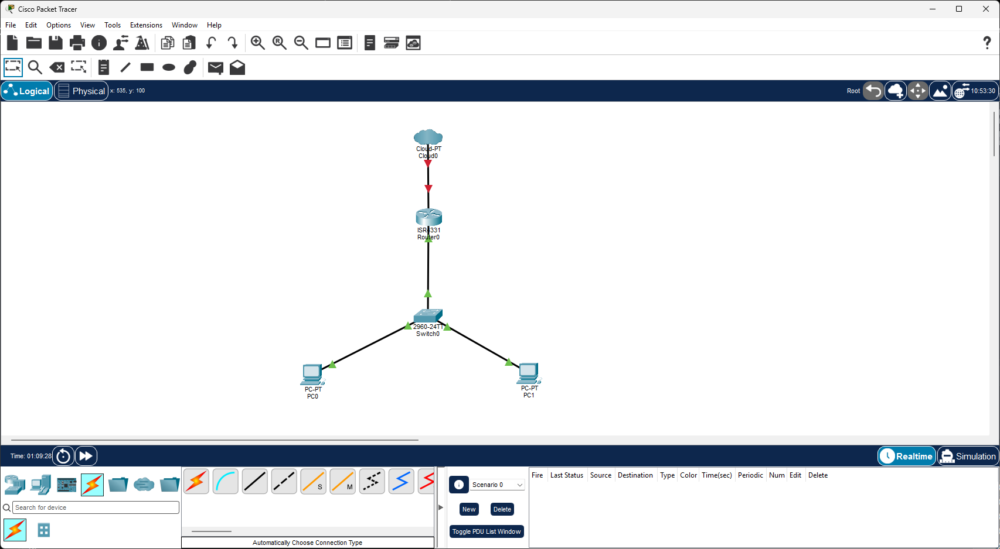

# Chapter 16: Inter-VLAN-Routing, DHCP & Extended ACL (Cisco Packet Tracer)

## 1. Ziel & Setup

Eigenständiges Netzwerk-Grundlagen-Lab in Cisco Packet Tracer, bewusst getrennt vom
Proxmox-basierten Haupt-Homelab dokumentiert — hier geht es nicht um Exploitation oder Detection,
sondern um die darunterliegende Netzwerk-Infrastruktur selbst: VLAN-Segmentierung,
Inter-VLAN-Routing, dynamische IP-Vergabe und Traffic-Filterung auf Layer 3.

**Topologie:** 1 Router (Cisco ISR 4331), 1 Switch (Cisco 2960-24TT), 2 Clients — jeweils ein
Client pro VLAN, verbunden über einen einzigen Trunk-Link zum Router ("Router-on-a-Stick").



Das Cloud0-Element oben am Router ist Teil der Standard-Packet-Tracer-Vorlage und für dieses
Lab ohne Funktion — relevant ist ausschließlich der Pfad Router0 → Switch0 → PC0/PC1.

| Komponente | VLAN | Netz | Gateway |
|---|---|---|---|
| Client A (PC0) | 10 | 192.168.10.0/24 | 192.168.10.1 |
| Client B (PC1) | 20 | 192.168.20.0/24 | 192.168.20.1 |

**Ziel:** Beide Clients sollen sich trotz unterschiedlicher VLANs gegenseitig erreichen können,
ihre IP-Konfiguration automatisch per DHCP vom Router bekommen — und zusätzlich soll eine gezielte
Richtung des ICMP-Verkehrs (Ping von VLAN 10 nach VLAN 20) blockiert werden, ohne die Gegenrichtung
oder sonstigen Traffic zu beeinträchtigen.

## 2. VLAN & Trunk (Switch)

VLANs 10 und 20 auf dem Switch angelegt, Access-Ports den Clients zugewiesen, ein Port als Trunk
zum Router konfiguriert:

```
interface FastEthernet0/1
 switchport mode access
 switchport access vlan 10

interface FastEthernet0/2
 switchport mode access
 switchport access vlan 20

interface GigabitEthernet0/1
 switchport trunk allowed vlan 10,20
```

**Begriffsklärung (wichtig für das Verständnis, nicht nur für die Syntax):** Access-Ports sind
**untagged** — der Client selbst weiß nichts von VLANs. Der Trunk-Port ist **tagged** — dort
laufen mehrere VLANs über ein einziges Kabel, jedes Frame trägt ein VLAN-Tag, damit Switch und
Router wissen, zu welchem VLAN es gehört.

## 3. Inter-VLAN-Routing (Router-on-a-Stick)

Pro VLAN ein eigenes Subinterface auf dem physischen Router-Interface, jeweils mit eigenem
802.1Q-Encapsulation-Tag und eigener IP:

```
interface GigabitEthernet0/0/0.10
 encapsulation dot1q 10
 ip address 192.168.10.1 255.255.255.0

interface GigabitEthernet0/0/0.20
 encapsulation dot1q 20
 ip address 192.168.20.1 255.255.255.0

interface GigabitEthernet0/0/0
 no shutdown
```

**Debugging-Moment:** Die Subinterface-Befehle (`encapsulation`, `ip address`) existieren nur
*innerhalb* eines Interface-Konfigurationsmodus — ein erster Versuch, sie direkt unter
`Router(config)#` einzugeben, scheiterte mit `% Invalid input detected`, weil kein vorheriger
`interface ...`-Wechsel stattgefunden hatte.

**Fund beim ersten Konnektivitätstest:** Client-zu-Gateway-Ping funktionierte sofort (VLAN-Zuordnung
und lokales Routing korrekt), aber der Ping ins jeweils andere VLAN schlug fehl. Root Cause:
vertauschte letzte Oktette beim Eintippen — Subinterface `.20` hatte versehentlich die Gateway-IP
`192.168.20.10` statt `192.168.20.1` erhalten. Gefunden durch systematisches Nachprüfen der
Interface-Konfiguration statt wahllosem Neustarten.

## 4. DHCP (Router als DHCP-Server)

Statt statischer Client-IPs: ein eigener DHCP-Pool pro VLAN direkt auf dem Router.

```
ip dhcp excluded-address 192.168.10.1
ip dhcp excluded-address 192.168.20.1

ip dhcp pool VLAN10_POOL
 network 192.168.10.0 255.255.255.0
 default-router 192.168.10.1
 dns-server 8.8.8.8

ip dhcp pool VLAN20_POOL
 network 192.168.20.0 255.255.255.0
 default-router 192.168.20.1
 dns-server 8.8.8.8
```

`excluded-address` verhindert, dass die Router-eigene Gateway-IP versehentlich an einen Client
vergeben wird — ohne diese Zeile würde der DHCP-Server irgendwann auch `.1` selbst verteilen.

**Verifikation:** Beide Clients auf "IP-Konfiguration automatisch beziehen" umgestellt — beide
erhielten korrekt IP, Maske und Gateway aus dem jeweiligen Pool, ohne manuelles Eingreifen.

## 5. Extended ACL — gerichtete ICMP-Filterung

**Anforderung:** Ping von VLAN 10 nach VLAN 20 soll blockiert werden, die Gegenrichtung
(VLAN 20 → VLAN 10) soll weiterhin funktionieren, und aller sonstige Traffic soll unberührt bleiben.

Eine Standard-ACL (nur Quell-IP-Filterung) reicht dafür nicht aus — benötigt wird eine
**Extended ACL** (Nummernbereich 100–199), da gleichzeitig Quelle, Ziel und Protokoll (ICMP)
geprüft werden müssen.

Erster Versuch:

```
access-list 101 deny icmp 192.168.10.0 0.0.0.255 192.168.20.0 0.0.0.255
access-list 101 permit ip 192.168.10.0 0.0.0.255 192.168.20.0 0.0.0.255
!
interface GigabitEthernet0/0/0.10
 ip access-group 101 in
```

(Jede ACL endet mit einer impliziten `deny any any` — ohne die zweite `permit`-Zeile wäre
sämtlicher Traffic zwischen den beiden Netzen blockiert gewesen, nicht nur ICMP.)

**Test:** Ping VLAN 10 → VLAN 20 korrekt blockiert (`Destination host unreachable`). Ping
VLAN 20 → VLAN 10 jedoch ebenfalls fehlgeschlagen (`Request timed out`) — unerwartet, da die ACL
nur am Interface `.10 in` angewendet war.

### Root-Cause-Analyse: ICMP Echo-Request vs. Echo-Reply

Die `deny icmp`-Zeile unterscheidet nicht zwischen ICMP-Nachrichtentypen — sie blockiert **jeden**
ICMP-Verkehr von Netz 10 nach Netz 20, in beide Rollen:

1. Client B (VLAN 20) pingt Client A (VLAN 10): Echo-**Request** läuft 20 → 10, trifft die ACL
   am Interface `.10` gar nicht (kommt über `.20` an, nicht über `.10`).
2. Client A antwortet mit einem Echo-**Reply**: Quelle `192.168.10.x`, Ziel `192.168.20.x` —
   dieses Antwortpaket läuft beim Verlassen des Netzes 10 erneut durch `.10 in` und matcht die
   `deny`-Regel, weil sie pauschal "ICMP von 10.0/24 nach 20.0/24" verbietet, unabhängig vom
   Nachrichtentyp. Die Antwort wird verworfen, der ursprüngliche Ping von VLAN 20 läuft in ein
   Timeout.

**Fix:** Die `deny`-Regel auf den ICMP-Nachrichtentyp `echo` (= Echo-**Request**) einschränken,
statt pauschal auf das Protokoll `icmp`:

```
no access-list 101
access-list 101 deny icmp 192.168.10.0 0.0.0.255 192.168.20.0 0.0.0.255 echo
access-list 101 permit ip 192.168.10.0 0.0.0.255 192.168.20.0 0.0.0.255
```

Damit matcht die `deny`-Regel ausschließlich die von VLAN 10 initiierte Ping-Anfrage —
Echo-Replies (unabhängig von der Richtung) fallen durch zur `permit`-Zeile. Danach beide
Richtungen wie gefordert: VLAN 10 → VLAN 20 geblockt, VLAN 20 → VLAN 10 funktioniert.

## 6. Kernlektionen

- **Access- vs. Trunk-Port ist eine Tagging-Frage, nicht nur ein Modus-Label:** Access-Ports sind
  untagged (Client kennt kein VLAN), nur der Trunk trägt VLAN-Tags — das ist leicht zu verwechseln,
  wenn man nur auf die Befehle schaut statt auf den tatsächlichen Frame-Inhalt.
- **Interface-gebundene Befehle brauchen den Moduswechsel:** `encapsulation` und `ip address`
  existieren nicht global — ein `% Invalid input detected` ist oft schlicht der fehlende
  `interface ...`-Schritt davor.
- **ACL-Richtung ist aus Router-Sicht zu denken, nicht aus Client-Sicht:** `in` am Interface `.10`
  heißt "Traffic, der von VLAN 10 beim Router ankommt" — nicht "Traffic Richtung VLAN 10".
- **ICMP ist nicht gleich ICMP:** Eine `deny icmp`-Regel ohne Typ-Einschränkung trifft Request
  *und* Reply gleichermaßen. Eine scheinbar einseitige Filterregel kann dadurch unbeabsichtigt
  auch die erlaubte Gegenrichtung lahmlegen, weil die Antwort eines erlaubten Pings denselben
  Quell-/Ziel-Adressbereich wie die verbotene Anfrage durchläuft — nur mit vertauschten Rollen.
- **Implizites `deny any any` am ACL-Ende nicht vergessen:** Jede ACL ohne abschließende
  `permit`-Zeile blockiert am Ende mehr, als beabsichtigt war.
