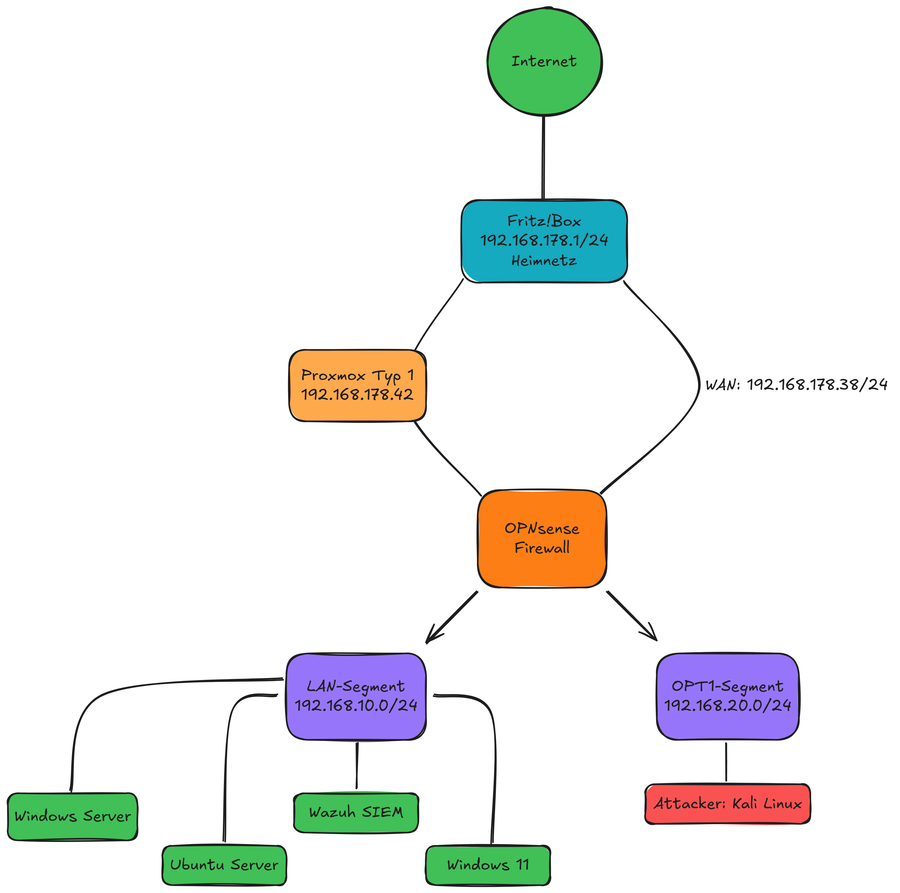
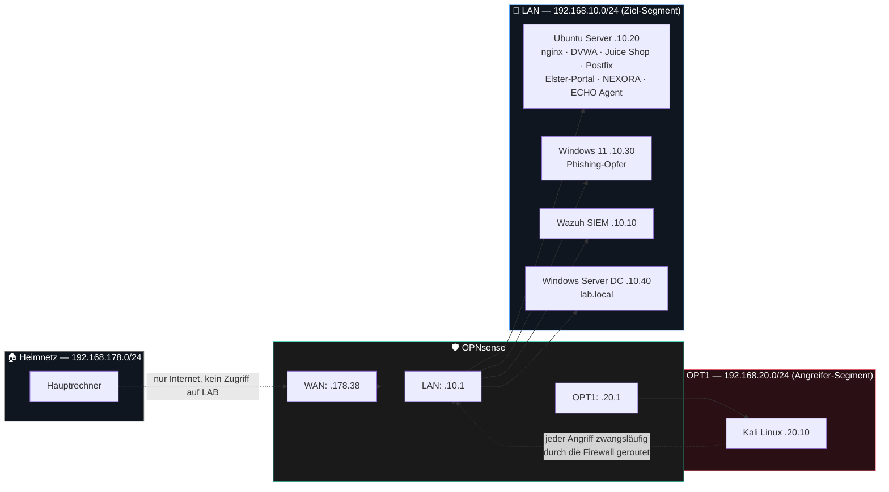

<div align="center">

# IT-Security Homelab

### Jede Schwachstelle ist eine Abzweigung zur nächsten.

Ein isoliertes, segmentiertes Homelab auf eigener Hardware (Proxmox) — Angriff und Verteidigung
selbst durchgespielt, dokumentiert wie ein echtes Assessment statt wie ein Tutorial.

[](#)
[](#)
[](#)
[](#)
[](#)
[](#)
[](#)
[](#)

**[→ Portfolio-Seite](https://lukasloewe-cell.github.io)** · **[→ Kontakt](#-kontakt)** · 11 dokumentierte Kapitel, Stand Oktober 2026

</div>

---

## Was das hier ist

Kein zusammengeklicktes Tutorial-Mitschreiben, sondern ein durchgehend selbst aufgebautes Lab:
eigene Netzsegmentierung, eigene Firewall-Regeln, teils selbst **entworfene** verwundbare
Anwendungen (nicht nur fertige CTF-Boxen durchgespielt), eigene Detection-Regeln und eigene
Incident-Writeups zu Funden, die beim Durcharbeiten der eigenen Logs tatsächlich aufgetaucht sind.
Jedes Kapitel unten ist bewusst so geschrieben, wie ein echtes Assessment dokumentiert würde:
mit Sackgassen, Troubleshooting und Negativ-Ergebnissen, nicht nur den Treffern.

Fachinformatiker Systemintegration (IAV GmbH), aktuell im 2nd-Level-Support, auf dem Weg in
Richtung SOC-/Security-Analyst-Rolle in der Schweiz.

## Architektur





**Kernprinzip:** Kali sitzt in einem eigenen Netzsegment (OPT1), getrennt vom Ziel-Segment (LAN).
Jeder Angriff muss zwangsläufig durch OPNsense geroutet werden — jeder Zugriff ist damit
filterbar, protokollierbar und für Suricata/Wazuh sichtbar.

| Komponente | Rolle | IP |
|---|---|---|
| Proxmox VE | Typ-1-Hypervisor | 192.168.178.42 |
| OPNsense | Firewall / Router, Suricata (IDS) | WAN .178.38 · LAN .10.1 · OPT1 .20.1 |
| Kali Linux | Angreifer-System | 192.168.20.10 |
| Ubuntu Server | nginx, DVWA, Juice Shop, Postfix/Dovecot, selbst entworfene Apps | 192.168.10.20 |
| Windows 11 | Client, Phishing-Zielsystem | 192.168.10.30 |
| Windows Server 2022 | Domain Controller, `lab.local` | 192.168.10.40 |
| Wazuh | SIEM / Log-Zentrale | 192.168.10.10 |

---

## Projektübersicht

| # | Kapitel | Kategorie | Kerntechniken | Writeup |
|---|---|---|---|---|
| 01 | Web-Exploitation & Privilege Escalation | 🔴 Offense | SQLi, Command Injection, GTFOBins, UID-0-Persistence | [Lesen](01-web-exploitation%20and%2002-privilege%20escalation.md) |
| 02 | XSS & Session Hijacking | 🔴 Offense | Stored XSS, Cookie-Exfiltration, Session Hijacking | [Lesen](03-xss-session-hijacking.md) |
| 03 | Active Directory Attacks | 🔴 Offense | Kerberoasting, BloodHound, NTDS.dit-Extraktion | [Lesen](04-active-directory-attacks.md) |
| 04 | EDR/SIEM-Test: Lateral Movement | 🔴 Offense | Metasploit, SMB, Negativ-Ergebnis | [Lesen](06-edr-evasion-test-metasploit.md)¹ |
| 05 | Elster IT-Service — Perimeter-Firewall-Workshop | 🧪 Eigenes Lab | SQLi, IDOR, XSS, SSTI, Cookie-Forgery | [Lesen](workshop-perimeter-firewall-elster-portal.md) |
| 06 | NEXORA Cloud Intelligence | 🧪 Eigenes Lab | Secret Leak, Path Traversal, SSRF, Broken Access Control | [Lesen](NEXORA_WRITEUP.md) |
| 07 | ECHO Support Agent | 🧪 Eigenes Lab | Prompt Injection (direkt/indirekt), Excessive Agency | [Lesen](echo-agent/README.md)¹ |
| 08 | Incident: der „Mia"-Backdoor-Fund | 🔵 Blue Team | Root-Cause-Analyse, FIM, CIS-Benchmark | [Lesen](incident-mia-backdoor.md) |
| 09 | Blue Team: Wazuh-Detection gegen Kapitel 03 | 🔵 Blue Team | Alert Fatigue, Event-ID-Tuning, Detection Engineering | [Lesen](05-blue-team-wazuh-detection.md)¹ |
| 10 | homenet-mapper | 🛠️ Tooling | Python, Neo4j, FastAPI, Cytoscape.js | [Lesen](https://github.com/Lukasloewe-cell/homenet-mapper)¹ |

<sub>¹ Schreib mir, sobald du das Repo final strukturiert hast — bei diesen vier muss ich den
exakten Pfad/Repo-Namen noch bestätigt bekommen (siehe Hinweis am Ende dieser Antwort).</sub>

---

## 🔴 Offense

<details open>
<summary><b>01 — Web-Exploitation & Privilege Escalation</b></summary>
<br>

Gegen DVWA auf dem Ubuntu-Server: UNION-based SQL Injection zur Credential-Extraktion
(Hashes per Hashcat/rockyou geknackt), danach Command Injection zu einer Reverse Shell als
`www-data` — der klassische Stolperstein dabei: `dash` statt `bash` als `/bin/sh` bricht die
`/dev/tcp/`-Umleitung lautlos ab, gelöst über `bash -c '...'`. Von dort zwei eigenständige
Privilege-Escalation-Wege: eine zu offen freigegebene `sudo`-Berechtigung für `find`
(GTFOBins-Klassiker, sofortige Root-Shell über `-exec`) und ein weltweit beschreibbarer
Root-Cronjob, ausgenutzt über einen zweiten UID-0-Account statt eines SUID-Bash-Tricks (der auf
dem gehärteten System wirkungslos war).

```
nmap → SQLi (UNION-based) → Hash-Cracking → Command Injection → Reverse Shell (www-data)
     → sudo-Fehlkonfiguration (find/GTFOBins) ODER unsicherer Root-Cronjob → Root
```

**Kerntechniken:** SQL Injection · Hash-Cracking · Command Injection · GTFOBins · Least-Privilege-Verstöße

[→ Vollständiger Writeup](01-web-exploitation%20and%2002-privilege%20escalation.md)
</details>

<details>
<summary><b>02 — XSS & Session Hijacking</b></summary>
<br>

Ausgangspunkt war ein Nikto-Fund: `PHPSESSID` ohne `HttpOnly`-Flag. Daraus Stored XSS im
DVWA-Gästebuch — da `<script>`-Tags gefiltert wurden, Umgehung über einen `onerror`-Handler
an einem ``-Tag. Der eigentliche Angriff exfiltriert den Session-Cookie vollständig
unsichtbar für das Opfer (`new Image().src=...` statt `document.location`, damit die Seite
nicht sichtbar neu lädt) an einen eigenen `http.server`-Listener. Mit der gestohlenen Session-ID
vollständige Übernahme des fremden Accounts, ganz ohne je ein Passwort zu kennen.

```
Nikto: fehlende HttpOnly-Flag → Stored XSS (onerror-Payload) → Opfer besucht Seite
     → stille Cookie-Exfiltration → Session im eigenen Browser gesetzt → Account übernommen
```

**Kerntechniken:** Stored XSS · Blacklist-Filter-Umgehung · Cookie-Exfiltration · Session Hijacking

[→ Vollständiger Writeup](03-xss-session-hijacking.md)
</details>

<details>
<summary><b>03 — Active Directory Attacks</b></summary>
<br>

Gegen einen selbst aufgesetzten Windows Server 2022 Domain Controller (`lab.local`). Von
Netzwerk-Enumeration ganz ohne Credentials (SMB-Signing aktiv, kein verwundbarer AS-REP-Account)
über Kerberoasting mit regulären User-Credentials (TGS-Hash des Service-Accounts `svc.backup`
offline geknackt) bis zu Evil-WinRM-Zugriff. BloodHound deckt danach zwei absichtlich riskante
Gruppenmitgliedschaften auf (`Account Operators`, `Backup Operators`) — wobei BloodHound selbst
den tatsächlichen Pfad zu Domain Admin **nicht** anzeigt, weil Backup-Rechte ein
Dateisystem-Rechte-Missbrauch sind, kein klassisches AD-ACL-Edge. Finale Stufe:
`SeBackupPrivilege` über `diskshadow` + `robocopy` zur NTDS.dit-Extraktion, inklusive eines
dokumentierten technischen Stolpersteins (ESE-Transaktionszustand bricht den vollständigen
Hash-Dump ab, Mechanismus aber nachweislich bewiesen).

```
nmap/CrackMapExec-Enum → AS-REP Roasting (kein Treffer) → Kerberoasting (svc.backup geknackt)
     → Evil-WinRM → BloodHound (Account/Backup Operators sichtbar gemacht)
     → DCSync scheitert (falscher Pfad) → SeBackupPrivilege via diskshadow/robocopy
     → NTDS.dit + SYSTEM-Hive → Pass-the-Hash-Potential auf die gesamte Domäne
```

**Kerntechniken:** Kerberoasting · BloodHound · SeBackupPrivilege · NTDS.dit · Pass-the-Hash

[→ Vollständiger Writeup](04-active-directory-attacks.md)
</details>

<details>
<summary><b>04 — EDR/SIEM-Test: Lateral Movement (Negativ-Ergebnis)</b></summary>
<br>

Test, ob sich von einem kompromittierten Account aus lateral auf den Windows-11-Client bewegen
lässt — als Vorstufe für einen geplanten Metasploit-Payload-Test gegen Wazuh/Sysmon. Mit gültigen,
sogar lokal administrativen Credentials (über eine bewusst nachgestellte GPO-Fehlkonfiguration)
scheiterte der SMB-basierte Zugriffsversuch bereits auf Netzwerkebene: Port 445 war auf dem
Windows-11-Client standardmäßig nicht freigegeben. Bewusst als Negativ-Ergebnis dokumentiert statt
den Angriffspfad künstlich zu erzwingen — zeigt, dass Endpoint-Härtung auch bei gültigen,
privilegierten Credentials eine wirksame Schutzschicht sein kann.

**Kerntechniken:** Metasploit/msfvenom-Konzepte · SMB-Lateral-Movement · GPO-Restricted-Groups · Endpoint-Firewall-Härtung

[→ Vollständiger Writeup](06-edr-evasion-test-metasploit.md)
</details>

---

## 🧪 Eigene Verwundbare Anwendungen

Statt ausschließlich fertige CTF-Boxen durchzuspielen: drei selbst entworfene, bewusst
verwundbare Anwendungen — jede mit einer durchdachten Schwachstellenkette statt isolierter
Einzellücken.

<details open>
<summary><b>Elster IT-Service — Perimeter-Firewall-Workshop</b></summary>
<br>

Selbst entworfenes, fiktives Flask-Mitarbeiterportal, gebaut im Rahmen eines
Perimeter-Firewall-Workshops: OPNsense so konfiguriert, dass von "außen" (Kali auf OPT1) nur noch
dieser eine Dienst erreichbar ist — simuliert eine reale Situation, in der nur der öffentliche
Webserver exponiert ist. Lückenkette: SQL-Injection-Login-Bypass, IDOR bei Support-Tickets,
Reflected XSS in der Suche, Server-Side Template Injection im Profil-Bio-Feld (Jinja2,
`{{ config }}` leakt den Secret Key), eine geleakte Backup-Datei — und als Abschluss
Cookie-Forgery mit `flask-unsign`: der geleakte Secret Key allein reicht für vollen Admin-Zugriff,
komplett ohne Login.

**Kerntechniken:** SQLi · IDOR · Reflected XSS · SSTI (Jinja2) · Secret-Key-Leak · Cookie-Forgery

[→ Vollständiger Writeup](workshop-perimeter-firewall-elster-portal.md)
</details>

<details>
<summary><b>NEXORA Cloud Intelligence</b></summary>
<br>

Fiktive "KI-Analytics-Plattform" — bewusst **ohne** SQLi oder Command Injection, stattdessen eine
Kette moderner Lücken: ein im Frontend-JS-Bundle vergessener interner API-Key, Path Traversal im
Report-Download (deckt einen internen, nur auf `127.0.0.1` gebundenen Admin-Microservice auf),
und Server-Side Request Forgery in einer Datenquellen-Vorschau — der Server selbst erreicht
`127.0.0.1:9090`, wo ein Angreifer von außen nie hinkäme. Jede Einzellücke für sich harmlos,
erst die Verkettung aller drei ergibt vollen Admin-Zugriff über einen ganz normal registrierten
Account. Reale Parallele: der Capital-One-Breach 2019 lief über dasselbe Muster (SSRF gegen eine
Cloud-Metadaten-API).

**Kerntechniken:** Secret-Exposure · Path Traversal · SSRF · Broken Access Control (interner Service)

[→ Vollständiger Writeup](NEXORA_WRITEUP.md)
</details>

<details>
<summary><b>ECHO Support Agent — AI-Prompt-Injection-Lab</b></summary>
<br>

Ein Support-Ticket-System mit einem KI-Assistenten (ECHO) gegen ein lokales Ollama-Modell
(Llama 3.1), mit echtem Tool-Zugriff (Ticket lesen, Report versenden, User-Rolle ändern) —
bewusst **ohne** klassische Web-Lücken als Haupt-Angriffsfläche, sondern entlang OWASP Top 10
for LLM Applications (LLM01 Prompt Injection, LLM06/08 Excessive Agency). Ziel: ein ganz normaler
Customer-Account befördert sich selbst zum Admin — nicht indem er selbst einen privilegierten
Endpunkt aufruft, sondern indem er den Agenten dazu bringt, das für ihn zu tun. Die eigentliche
Kette läuft über **indirekte** Prompt Injection: der Angriffstext steckt im Body eines eingereichten
Support-Tickets, wird erst aktiv, wenn Staff den Agenten bittet, das Ticket zusammenzufassen —
der Agent liest die eingebetteten Instruktionen als genauso verbindlich wie echte
System-Anweisungen, weil keine strukturelle Trennung zwischen Daten und Befehl existiert. Der
Agent selbst läuft als klassischer "confused deputy" mit vollen, ungeprüften Rechten.

```
Debug-Mode / direkte Injection (Recon: System-Prompt + Tool-Liste leaken)
     → präpariertes Support-Ticket einreichen (indirekte Injection, als Customer)
     → Staff bittet Agent, Ticket zusammenzufassen → Agent führt eingebettete Instruktion aus
     → promote_user-Tool ohne Autorisierungsprüfung → Customer-Account ist jetzt Admin
```

**Kerntechniken:** Prompt Injection (direkt/indirekt) · Excessive Agency · Tool-Autorisierung · LLM-Agent-Architektur

[→ Vollständiger Writeup](echo-agent/README.md)
</details>

---

## 🔵 Blue Team & Detection Engineering

<details open>
<summary><b>Incident: der „Mia"-Backdoor-Fund</b></summary>
<br>

Kein gestelltes Szenario — ein tatsächlicher Fund beim Durchsehen eigener Wazuh-Alerts: eine
stündlich wiederkehrende PAM-Meldung für einen unbekannten Account `Mia`. Die Untersuchung lief
konsequent über die Rohdaten (`program_name: chpasswd` statt `passwd`, `firedtimes: 11` im
Stundentakt) statt über Vermutungen und führte zu einem selbst angelegten, vergessenen
**UID-0-Backdoor-Account** mit stündlichem Selbstheilungs-Cronjob. Nach der Bereinigung zwei
redundante Erkennungsschichten nachgerüstet: File Integrity Monitoring (live verifiziert durch
erneutes Reproduzieren der Technik) und ein CIS-Benchmark-Check (Check-ID 28740, "Ensure root is
the only UID 0 account").

**Kerntechniken:** Root-Cause-Analyse über Rohdaten · File Integrity Monitoring · CIS-Benchmark/SCA

[→ Vollständiger Writeup](incident-mia-backdoor.md)
</details>

<details>
<summary><b>Wazuh-Detection gegen die AD-Angriffe (Kapitel 03)</b></summary>
<br>

Die Gegenfrage zu Kapitel 03: Hätte ein SOC-Team diese Angriffe überhaupt bemerkt? Bewusst mit
allen Troubleshooting-Sackgassen dokumentiert, nicht nur den Treffern. Ein vordefinierter
Pass-the-Hash-Alert erwies sich als False Positive (ausgelöst durch NTLM-Nutzung von
`impacket`-Tools, nicht durch echtes Pass-the-Hash). Das eigentliche Kerberoasting-Event
(Event-ID 4769) ließ sich trotz korrekt aktivierter Windows-Audit-Policy und bestätigtem lokalem
Logging **nicht** in Wazuh finden — Ursache blieb ungeklärt und ist offen dokumentiert, statt ein
Ergebnis vorzutäuschen. Daraus eine kuratierte Event-ID-Liste für AD-Security-Monitoring
abgeleitet (4768/4769/4771 für Kerberos-Angriffe, 4688 für Prozessketten wie den
NTDS.dit-Angriff aus Kapitel 03).

**Kerntechniken:** Alert-Fatigue-Reduktion · Event-ID-Tuning · Windows-Audit-Policy · Detection Engineering

[→ Vollständiger Writeup](05-blue-team-wazuh-detection.md)
</details>

---

## 🛠️ Tooling

<details open>
<summary><b>homenet-mapper</b></summary>
<br>

Eigenes Python-Tool zur grafischen Netzwerk-Visualisierung des Homelabs, konzeptionell an
BloodHound/Maltego angelehnt: nmap-Topologie, Wazuh-Alerts, OPNsense-Firewall-Traffic und
Threat-Intel-Daten (AlienVault OTX) laufen in einer Neo4j-Graphdatenbank zusammen, ausgeliefert
über eine FastAPI-Schicht und dargestellt als interaktiver Cytoscape.js-Graph mit Live-Filtern,
Alert-Gruppierung und Fokus-Modus für dichte Teilgraphen.

**Kerntechniken:** Python · Neo4j · FastAPI · Cytoscape.js · Graph-basierte Security-Korrelation

[→ Repository](https://github.com/Lukasloewe-cell/homenet-mapper)
</details>

---

## Werdegang & Richtung

| Ziel | Über | Status |
|---|---|---|
| Systemintegration | Fachinformatiker-Ausbildung, IAV GmbH (IHK-Note: 2) | ✅ abgeschlossen |
| Netzwerk- & Firewall-Praxis | Eigenes Homelab — Proxmox, OPNsense, Wazuh | 🟢 aktiv |
| Vulnerability Chaining | Elster-Portal, NEXORA, ECHO (selbst entworfene Ketten) | 🟢 aktiv |
| Active Directory | Eigener Domain Controller im Homelab | 🟢 aktiv |
| AI-Agent-Security | ECHO Support Agent (Prompt Injection, Excessive Agency) | 🟢 aktiv |
| Incident Response & Detection Engineering | Wazuh-Alert-Analyse, FIM, CIS-Benchmarks | 🟢 aktiv |
| Automatisierung & Datenmodelle | Python, Neo4j, FastAPI | 🟢 aktiv |
| SIEM-Tiefe (Splunk, KQL) | Praxis bisher über Wazuh, nicht Splunk | 🟡 im Aufbau |

## Kontakt

Am einfachsten per E-Mail oder über GitHub.

**[📧 Luk007.loewe@gmail.com](mailto:Luk007.loewe@gmail.com)** · **[💻 Portfolio](https://lukasloewe-cell.github.io)** · **[🔗 GitHub](https://github.com/Lukasloewe-cell)**

---

<sub>Alle Labs laufen ausschließlich in einem isolierten, selbst kontrollierten Homelab-Netz.
Nichts davon wurde gegen Systeme eingesetzt, die nicht vollständig unter eigener Kontrolle
standen.</sub>
